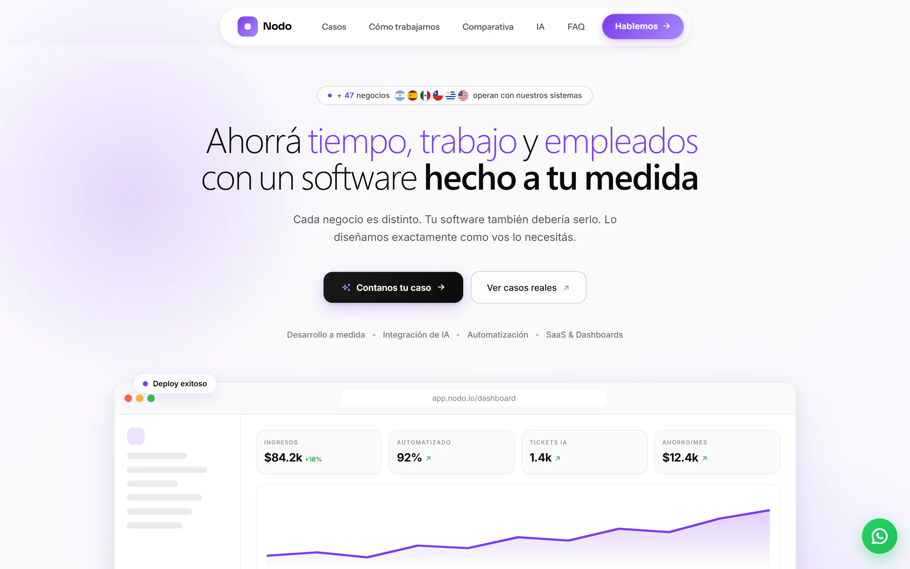

# Nodo

> An AI sales assistant: it understands each business, proposes a solution, and saves the lead in the CRM.

**Status:** Live · https://nodo-web-ma3o.vercel.app
**Models:** Claude Sonnet 4.6 (conversation) · Claude Haiku 4.5 (lead extraction)

## What it is

Nodo builds custom software. Each inquiry was different, and before giving a useful answer there were several rounds of back-and-forth just to understand the case.

## How it works

The solution is an assistant on the website that asks a few questions and proposes something concrete. When the conversation ends, a second model reads it and builds the lead with the data in order. Nobody copies anything by hand.

1. **Visitor** writes in the chat on the website.
2. **Claude Sonnet 4.6** replies briefly and fast, with a cached system prompt.
3. **End of conversation:** the website sends the transcript to the server.
4. **Claude Haiku 4.5** extracts the lead with structured outputs.
5. **Folk and Telegram:** the lead lands in the CRM and the team gets a notification.

## How the AI is used

**The model does:**
- Claude Sonnet 4.6 talks with the visitor, understands the case and proposes a solution.
- At the end, Claude Haiku 4.5 reads the conversation and returns the lead as JSON with a fixed schema.

**The code controls:**
- Limits: 40 messages every 10 minutes per IP, and 12 extractions per IP.
- Only the last 16 messages go to the model.
- Conversations under 40 characters don't call the extractor.
- If a step fails, the JSON is kept in the log.

**A person decides:** the team gets the notification in Telegram and follows the contact from there.

## Design decisions

- **One model per task.** Good conversation needs a large model; pulling data out of text doesn't. Haiku is faster and cheaper for that.
- **Cached system prompt.** The prompt is long and doesn't change between messages, so with caching each reply costs less and arrives sooner.
- **Fast replies.** In a sales chat speed matters, so the model runs without extended reasoning and at low effort.

## Stack

Next.js · TypeScript · Anthropic SDK · Folk API · Telegram Bot API · Vercel

## Numbers

- 2 models, one per task
- 40 messages per IP every 10 minutes
- 16 messages of context

---

The source code is private. This repository explains how the project works, not its code.
Portfolio: https://ignaciomoralesdev.vercel.app
